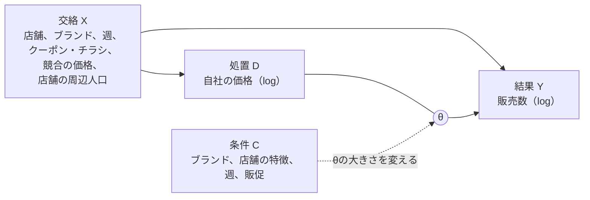
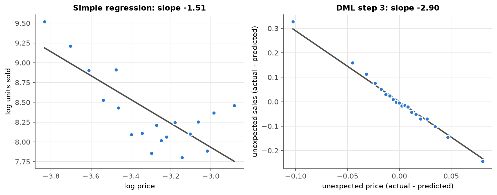
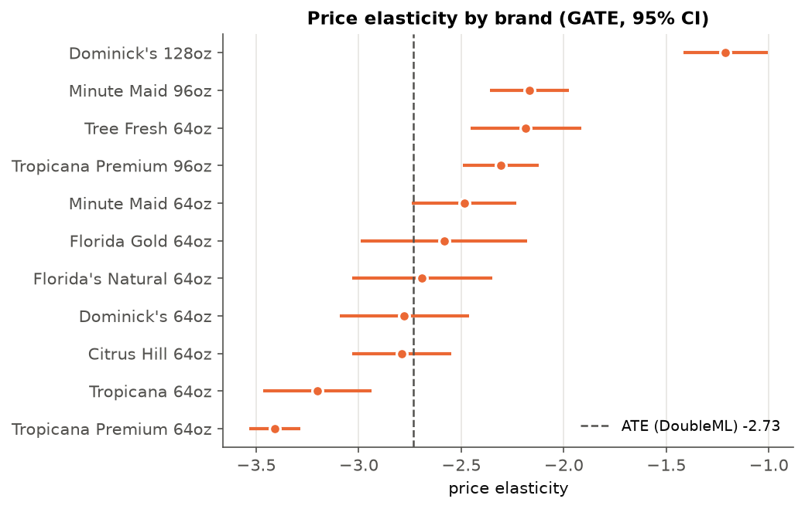
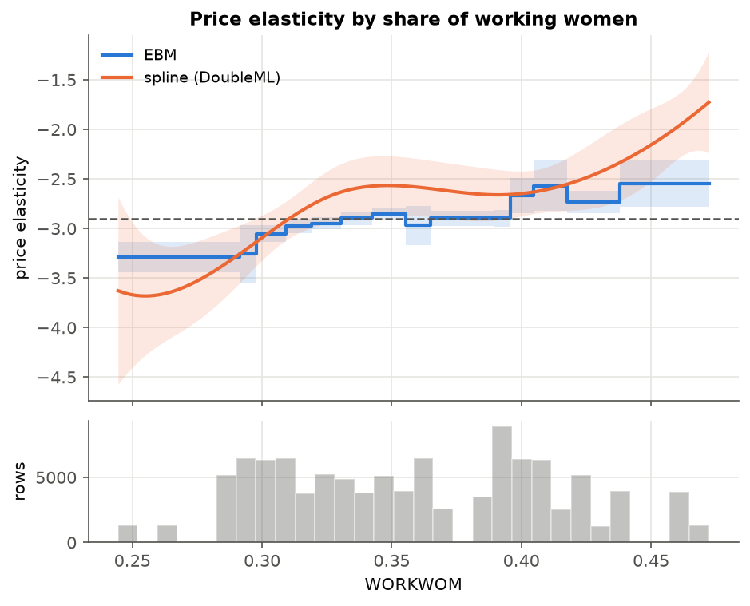
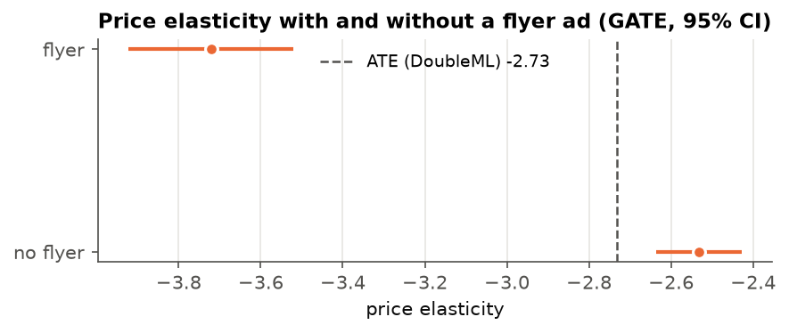

# DMLとEBMによるオレンジジュースの価格弾力性の推定

[English](README.md) | 日本語

## 1. 目的

**商品の値下げによる販売数へのピュアな影響**をみることはできるだろうか。

一見、値下げは販売数に貢献しているようにみえたとする。
しかし、値下げが**クーポンやチラシ広告**と同時に行われるとき、販売数増加には**広告効果**が含まれている可能性がある。
一方、高級ブランドは高くてもよく売れる。ブランドの違いを考えずに比べると「価格が高くても売れる」ように見え、値下げの効果が小さく見える可能性がある。


本プロジェクトでは、以下を検証する。

- Double Machine Learning（DML）を使い、他の影響（交絡）を取り除いたうえで、価格が販売数に与える効果を推定する
- その効果が条件C（ブランド、店舗の特徴、時期、販促）によってどう変わるかを、DoubleMLのスプラインと、Explainable Boosting Machine（EBM）で調べる



θ ：価格弾力性（価格を1%上げたときに販売数が何%変わるか）

**データ：** シカゴのスーパー Dominick's Finer Foods の冷蔵オレンジジュースの週次販売データ（83店舗、11ブランド、約10万6千行）。Rパッケージ [bayesm](https://cran.r-project.org/package=bayesm) の `orangeJuice` で、出典は Montgomery (1997), *Marketing Science* 16(4) 

## 2. ATE、CATE、GATE

- **ATE（平均処置効果）：** データ全体で1つの数字。「平均すると、価格を1%上げると販売数が2.9%減る」
- **CATE（条件付き平均処置効果）：** ある条件の値ごとの効果（条件は連続的な値でもよい）店舗の所得に沿ったカーブとして表される
- **GATE（グループ平均処置効果）：** あらかじめ決めたグループごとのCATE。たとえばブランドごと、チラシのある週とない週など

ATEは、データ全体で価格が値下げにどのくらい効くかを見る。CATEとGATEは、どこ条件でより効くかを提示する。ビジネスでの意思決定（どこで値下げするか）に必要なのは後者。

## 3. 方法：3つの手順

1. **X（交絡）から販売数を予測** LightGBMで、交絡だけを使って販売数を予想する。実際の値 － 予測 ＝ 販売数の残差
2. **X（交絡）から価格を予測** 価格についても同じことを行う。実際の値 － 予測 ＝ 価格の残差
3. **2つの残差を回帰** その傾きが θ である

残差にはXの影響が含まれていないため、傾きは価格の効果のみを表す。

## 4. CATEを推定する2つの方法

どちらも手順1と2は同じで、手順3だけが変わる。θ を条件Cの関数にする。

**スプライン（DoubleML）** 傾き θ が、ある条件（例：所得）に沿ってなめらかに変わるカーブを推定する。
1. 所得を、数本の「部品」（Bスプライン基底）に変換する。部品は、それぞれ担当する所得帯で山になる曲線で、重みをつけて足し合わせれば、なめらかなカーブが作れる
2. θ を「部品の重みつきの和」とおき、手順3の式（販売の残差 ＝ θ × 価格の残差）に入れる。展開すると、「部品 × 価格の残差」を説明変数とする線形回帰になる
3. 回帰で求めた重みから、所得ごとの θ のカーブと、その信頼区間が得られる

**EBM** GAM（一般化加法モデル）の一種。

```
予測値 = 切片 + f1(変数1) + f2(変数2) + ...
```

各 f はブースティングで学習するため、各説明変数の関数は柔軟な形をとれる。1つの f をグラフにしたものを **Shape** と呼ぶ。ここではEBMで θを予測する（目的変数を `販売数の残差 / 価格の残差`、重みを `価格の残差²` にして学習）そのため、各Shapeは、ある条件によって価格の効果がどう変わるかを表す。予測区間は内部のバギングから出したもので、本来の信頼区間より狭い。

## 5. 結果

### まとめ

| 方法 | 価格弾力性（95%信頼区間） |
|---|---|
| 素朴な回帰（交絡なし） | -1.51 |
| DML、スクラッチ（ATE） | -2.90（-3.10 〜 -2.70） |
| DML、DoubleMLパッケージ（ATE） | -2.73（-2.83 〜 -2.64） |

素朴な回帰では、価格の効果が実際よりかなり小さく見える。2つのDMLの結果が少し違うのは、店舗の変数をモデルに入れる方法（カテゴリ変数かダミー変数か）が違うため。

CATEとGATE：

| 条件 | グループまたは値 | 価格弾力性（95%信頼区間） | 方法 |
|---|---|---|---|
| ブランド | Tropicana Premium 64oz | -3.41（-3.53 〜 -3.28） | GATE |
| | Tropicana 64oz | -3.20（-3.47 〜 -2.94） | GATE |
| | Minute Maid 64oz | -2.49（-2.74 〜 -2.23） | GATE |
| | Tropicana Premium 96oz | -2.31（-2.49 〜 -2.12） | GATE |
| | Minute Maid 96oz | -2.17（-2.36 〜 -1.97） | GATE |
| | Dominick's 128oz | -1.21（-1.42 〜 -1.01） | GATE |
| チラシ広告 | あり | -3.72（-3.92 〜 -3.52） | GATE |
| | なし | -2.53（-2.64 〜 -2.43） | GATE |
| 店舗の所得 | 下位1/3 | -3.20（-3.45 〜 -2.95） | GATE |
| | 中位1/3 | -2.69（-3.10 〜 -2.28） | GATE |
| | 上位1/3 | -2.75（-3.00 〜 -2.51） | GATE |
| 働く女性の割合 | 0.30 | -3.09（-3.25 〜 -2.94） | スプライン |
| | 0.35 | -2.57（-2.77 〜 -2.36） | スプライン |
| | 0.40 | -2.65（-2.80 〜 -2.49） | スプライン |
| | 0.45 | -2.16（-2.41 〜 -1.90） | スプライン |

すべての結果は、下記参照。

### 素朴な回帰とDMLの比較



各点は約5,300行の平均。右の図では交絡が取り除かれており、点が一直線に並ぶ。

### どの交絡が特に効いているか

交絡のグループを1つずつ外して、DMLを回す

| 外した交絡 | 価格弾力性 | 変化 |
|---|---|---|
| （なし） | -2.90 | |
| ブランド | -1.66 | +1.24 |
| クーポン・チラシ広告 | -4.05 | -1.15 |
| 店舗 | -2.54 | +0.36 |
| 週 | -3.18 | -0.28 |
| 競合の価格 | -2.77 | +0.13 |
| 店舗の周辺人口 | -2.80 | +0.10 |

- ブランドを外すと、価格の効果は小さく見える。高級ブランドは高くても売れるため、「価格が高くても売れる」ように見え、値下げの効果が小さく見えたか。
- 販促を外すと、価格の効果は大きく見える。チラシやクーポンによる販売増まで、価格の効果に数えてしまうか。

### ブランド別



大容量（96ozと128oz）は、64ozより価格に鈍感。最も敏感なのは Tropicana 64oz と Tropicana Premium 64oz。

### 働く女性の割合別



働く女性の割合が高い地域の店ほど、価格に鈍感。
EBMとスプラインは同じ右上がりの傾向を示す。スプラインのほうが急なのは、この変数だけを見ているためで、EBM（16の条件）は他の条件をそろえたうえでの違いを見ている。
下の棒はデータの行数で、データの少ない両端ではスプラインの帯が広い。

### チラシ広告の有無別



商品がチラシに載っている週（全体の18%）は、値下げの効き目が大きい。

## 限界

- DMLが取り除けるのは、Xに入れた交絡のみ。
- 店舗の特徴は83通り（店舗ごとに1つ）しか値がないので、EBMを使用した場合、そのShapeはぶれやすい
- 販促期間のデータは、価格の効果を大きく見せることがある。セール中にまとめ買いした客は、その後の数週間あまり買わない可能性がある

## 実行方法

```
pip install numpy pandas matplotlib scikit-learn lightgbm interpret doubleml rdata patsy
```

`src/dml_orange_juice.ipynb` を開き、すべてのセルを実行する。データはノートブックの実行時に、GitHub上のCRANミラーからダウンロードされる。
