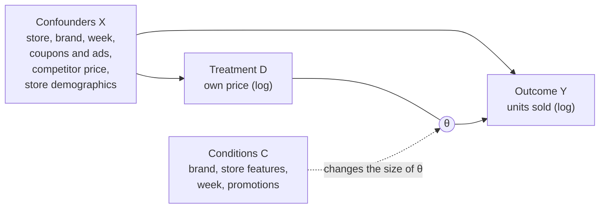

# Price elasticity of orange juice with DML and EBM

English | [日本語](README.ja.md)

## 1. Purpose

When a store cuts the price of a product, sales go up. But how much of that increase comes from the price cut itself?

This is hard to see in the raw data. Price cuts often happen together with coupons and flyer ads, and premium brands sell well even at high prices. A simple regression mixes these effects with the effect of price.

In this project I:

- estimate the effect of price on sales after removing these other effects (confounders), using Double Machine Learning (DML)
- check how the effect changes by condition C (brand, store features, week, promotions), with a spline from DoubleML and with an Explainable Boosting Machine (EBM)



θ is the price elasticity: the % change in units sold when the price goes up by 1%.

**Data:** weekly sales of refrigerated orange juice at Dominick's Finer Foods in Chicago (83 stores, 11 brands, about 106,000 rows). It is the `orangeJuice` dataset in the R package [bayesm](https://cran.r-project.org/package=bayesm), from Montgomery (1997), *Marketing Science* 16(4).

## 2. ATE, CATE and GATE

- **ATE (Average Treatment Effect):** one number for the whole data. "On average, a 1% price increase lowers sales by 2.9%."
- **CATE (Conditional Average Treatment Effect):** the effect for a given value of a condition. The condition can be continuous, so the CATE can be a curve, for example along store income.
- **GATE (Group Average Treatment Effect):** the CATE for groups you define in advance, such as brands, or weeks with and without a flyer ad.

The ATE tells you whether price matters. The CATE and GATE tell you where it matters more, which is what you need to decide where to cut prices.

## 3. Method: three steps

1. **Predict sales from X.** Use LightGBM to predict units sold from the confounders only. The residual (actual minus predicted) is the "unexpected" part of sales.
2. **Predict price from X.** Do the same for price. The residual is the "unexpected" part of price.
3. **Fit a line between the two residuals.** The slope is θ.

The residuals no longer contain the effect of X, so the slope only reflects the effect of price. Steps 1 and 2 use 5-fold cross-fitting: each row is predicted by a model that did not see that row.

## 4. Two ways to estimate the CATE

For both, steps 1 and 2 stay the same. Only step 3 changes: θ becomes a function of C.

**Spline (DoubleML).** Estimates θ as a smooth curve along one condition, such as income.

1. Turn income into a few "parts": bell-shaped curves, each covering one income range. Any smooth curve can be made as a weighted sum of these parts.
2. Write θ as a weighted sum of the parts and put it into step 3 (residual sales = θ × residual price). Expanding the brackets gives an ordinary linear regression on "part × residual price".
3. The fitted weights give θ for each income level, with a confidence band.


**EBM.** An EBM is a type of GAM (Generalized Additive Model):

```
prediction = intercept + f1(feature 1) + f2(feature 2) + ...
```

Each f is learned with boosted trees and can take any shape. Plotting one f gives a curve called a **shape**. Here the EBM predicts θ itself: it fits `residual sales / residual price` with weight `residual price²`. So each shape shows how the effect of price changes with one condition. It handles many conditions and categories at once, but its bands come only from internal bagging and are too narrow.

I use the EBM to find which conditions matter, and the spline or GATE from DoubleML to confirm them.

## 5. Results

### Summary

| Method | Price elasticity (95% CI) |
|---|---|
| Simple regression (no confounders) | -1.51 |
| DML, my implementation (ATE) | -2.90 (-3.10 to -2.70) |
| DML, DoubleML package (ATE) | -2.73 (-2.83 to -2.64) |

The simple regression makes price look much less important than it is. The two DML results differ a little because the store variable enters the models in different ways (category vs dummy columns).

CATE and GATE:

| Condition | Group or value | Price elasticity (95% CI) | Method |
|---|---|---|---|
| Brand | Tropicana Premium 64oz | -3.41 (-3.53 to -3.28) | GATE |
| | Tropicana 64oz | -3.20 (-3.47 to -2.94) | GATE |
| | Minute Maid 64oz | -2.49 (-2.74 to -2.23) | GATE |
| | Tropicana Premium 96oz | -2.31 (-2.49 to -2.12) | GATE |
| | Minute Maid 96oz | -2.17 (-2.36 to -1.97) | GATE |
| | Dominick's 128oz | -1.21 (-1.42 to -1.01) | GATE |
| Flyer ad | with flyer | -3.72 (-3.92 to -3.52) | GATE |
| | without flyer | -2.53 (-2.64 to -2.43) | GATE |
| Store income | lowest third | -3.20 (-3.45 to -2.95) | step 3 by group |
| | middle third | -2.69 (-3.10 to -2.28) | step 3 by group |
| | highest third | -2.75 (-3.00 to -2.51) | step 3 by group |
| Share of working women | 0.30 | -3.09 (-3.25 to -2.94) | spline |
| | 0.35 | -2.57 (-2.77 to -2.36) | spline |
| | 0.40 | -2.65 (-2.80 to -2.49) | spline |
| | 0.45 | -2.16 (-2.41 to -1.90) | spline |

All 11 brands are in the brand figure below. The spline intervals in this table are for each point; the band in the figure covers the whole curve, so it is wider.

### Simple regression vs DML


Each point is the average of about 5,300 rows. On the right, the confounders are removed and the points fall on one line.

### Which confounders matter most

I removed one group of confounders at a time and ran DML again.

| Removed | Elasticity | Change |
|---|---|---|
| (none) | -2.90 | |
| Brand | -1.66 | +1.24 |
| Coupons and flyer ads | -4.05 | -1.15 |
| Store | -2.54 | +0.36 |
| Week | -3.18 | -0.28 |
| Competitor price | -2.77 | +0.13 |
| Store demographics | -2.80 | +0.10 |

Without brand, price looks less important, because expensive brands sell well. Without promotions, price looks more important, because the sales lift from flyers and coupons is counted as a price effect.

### By brand


Large packs (96 oz and 128 oz) are much less sensitive to price than 64 oz packs. Tropicana 64 oz and Tropicana Premium 64 oz are the most sensitive.

### By share of working women


Stores in areas with more working women are less sensitive to price. The EBM and the spline show the same upward trend. The spline is steeper because it looks at this variable alone, while the EBM (16 conditions) holds the other conditions fixed. The bars below show the number of rows; the spline band is wide at both ends where there is little data.

### With and without a flyer ad


Price cuts work much better in weeks when the product is in the flyer (18% of rows).

## Limitations

- DML only removes the confounders that are in X. If stores set prices based on demand they expected but we cannot see, the estimate is still biased.
- Store features have only 83 distinct values (one per store), so their shapes can be noisy.

## 6. Comparison with doubleml-pipeline

I also ran the same data through [doubleml-pipeline](https://github.com/google/doubleml-pipeline) by Google's APAC Marketing Effectiveness team. It wraps DoubleML with AutoML and runs the whole process with one call: it picks the learners, repeats the estimation, builds confidence bands, fits the CATE, and runs a sensitivity analysis.

| | My implementation | doubleml-pipeline |
|---|---|---|
| ATE (95% CI) | -2.90 (-3.10 to -2.70) | -2.58 (-2.90 to -2.26) |
| Learners | LightGBM, fixed | chosen automatically (XGBoost for both) |
| Clusters for inference | store | store and month |
| Flyer / no flyer | -3.72 / -2.53 | -3.23 / -2.26 |
| Large pack / others | -1.2 to -2.3 / -2.5 to -3.4 | -1.60 / -2.75 |
| Share of working women | upward trend | upward trend |
| Store income | weak | not significant |

The direction of every result is the same. The pipeline gives a slightly smaller ATE and a wider interval, because it clusters by both store and month, and keeps the same store and month apart in cross-fitting. I had not thought about the month dimension.

What I found useful:

- One short script covers learner selection, repeated estimation, CATE and the sensitivity analysis.
- The sensitivity analysis shows how strong a hidden confounder would need to be to change the result. Here the robustness value was about 40%, so the result is quite robust.
- It chooses cluster keys and the cross-fitting design automatically, which is easy to get wrong by hand.

## How to run

```
pip install numpy pandas matplotlib scikit-learn lightgbm interpret doubleml rdata patsy
```

Open `src/dml_orange_juice.ipynb` and run all cells. The data is downloaded from the CRAN mirror on GitHub when you run the notebook. DoubleML splits the data at random, so set `np.random.seed(0)` before `model.fit()` to get the same numbers.
To run doubleml-pipeline, install `doubleml-pipeline` and `flaml[automl]`, then run the cell in `src/pipeline_cell.py`.