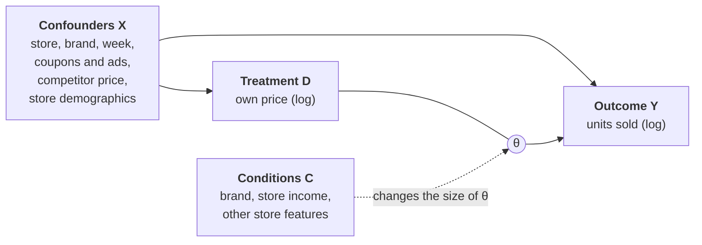

# Price elasticity of orange juice with DML and EBM

## 1. Purpose

When a store cuts the price of a product, sales go up. But how much of that increase comes from the price cut itself?

This is hard to see in the raw data. Price cuts often happen together with coupons and flyer ads, and premium brands sell well even at high prices. A simple regression mixes these effects with the effect of price.

In this project I:

- estimate the effect of price on sales after removing these other effects (confounders), using Double Machine Learning (DML)
- check how the effect changes by condition C (brand, store income and other store features), and show it as a curve for each condition with an Explainable Boosting Machine (EBM)



θ is the price elasticity: the % change in units sold when the price goes up by 1%.

**Data:** weekly sales of refrigerated orange juice at Dominick's Finer Foods in Chicago (83 stores, 11 brands, about 106,000 rows). It is the `orangeJuice` dataset in the R package [bayesm](https://cran.r-project.org/package=bayesm), from Montgomery (1997), *Marketing Science* 16(4).

## 2. ATE and CATE

- **ATE (Average Treatment Effect):** one number for the whole data. "On average, a 1% price increase lowers sales by 2.9%."
- **CATE (Conditional Average Treatment Effect):** the effect for a given condition. "For brand A it is -3.6%, for brand B it is -1.6%."

The ATE is the average of the CATEs. The ATE tells you whether price matters. The CATE tells you where it matters more, which is what you need to decide where to cut prices.

## 3. EBM

An EBM is a type of GAM (Generalized Additive Model). The prediction is the sum of one function per feature:

```
prediction = intercept + f1(feature 1) + f2(feature 2) + ...
```

Each function f is learned with boosted trees, so it can take any shape. You can plot each f as a curve, called a **shape**, and see how one feature moves the prediction.

In this project the EBM does not predict sales. It predicts the price elasticity θ, so each shape shows how the effect of price changes with one condition.

## 4. Method: three steps

1. **Predict sales from X.** Use LightGBM to predict units sold from the confounders only. The residual (actual minus predicted) is the "unexpected" part of sales.
2. **Predict price from X.** Do the same for price. The residual is the "unexpected" part of price.
3. **Fit a line between the two residuals.** The slope is θ.

The residuals no longer contain the effect of X, so the slope only reflects the effect of price. Steps 1 and 2 use 5-fold cross-fitting: each row is predicted by a model that did not see that row.

For the CATE, steps 1 and 2 stay the same. Only step 3 changes: the EBM learns θ as a function of C. In practice it fits `residual sales / residual price` with weight `residual price²`.

## 5. Results

| Method | Price elasticity |
|---|---|
| Simple regression (no confounders) | -1.51 |
| DML (ATE) | -2.90 (95% CI: -3.10 to -2.70) |

The simple regression makes price look much less important than it is. The DML result was close to the result from the [DoubleML](https://docs.doubleml.org) package (-2.77).

**By brand**


Large packs (96 oz and 128 oz) are much less sensitive to price than 64 oz packs. Tropicana 64 oz and Tropicana Premium 64 oz are the most sensitive.

**By store income**


The effect changes only a little with income (about -3.0 to -2.7) once other store features are in the model. The dashed line is the ATE.

The bands come from the EBM's internal bagging. They do not include the uncertainty from steps 1 and 2, so the true intervals are wider.

## Limitations

- DML only removes the confounders that are in X. If stores set prices based on demand they expected but we cannot see, the estimate is still biased.
- Store features have only 83 distinct values (one per store), so their shapes can be noisy.

## How to run

```
pip install numpy pandas matplotlib scikit-learn lightgbm interpret doubleml rdata
```

Open `dml_orange_juice.ipynb` and run all cells. The data is downloaded from the CRAN mirror on GitHub when you run the notebook.
